# Lexta Business System: Staff User Guide

**Draft for review, 12 November 2026.** Prepared by 1773 Human Resources & Marketing Services LTD for Lexta Ghana Limited.

This guide shows you how to use the Lexta Business System, the staff portal behind the Lexta websites. It covers every system you can open from the menu, with steps and pictures. The pictures were taken with made up demo data (names such as "Ama Demo" and "Demo Shop Adabraka"), so your screens will show your own records.

If something in this guide does not match what you see, or a step does not work, tell your admin. The system is still being finished, so a few screens may change.

## Contents

1. [Getting started](#1-getting-started)
2. [Management dashboard](#2-management-dashboard)
3. [Distributor ordering](#3-distributor-ordering)
4. [Field sales](#4-field-sales)
5. [CRM](#5-crm)
6. [Complaints](#6-complaints)
7. [Product management](#7-product-management)
8. [Stockists (Where to Buy)](#8-stockists-where-to-buy)
9. [CSR activities](#9-csr-activities)
10. [Recruitment](#10-recruitment)
11. [Live chat inbox](#11-live-chat-inbox)
12. [Users and access](#12-users-and-access)
13. [Who to ask](#13-who-to-ask)
14. [Glossary](#14-glossary)

Short videos of the main tasks are listed under [Videos](#videos).

## Videos

Each video shows one task from start to finish, with a caption bar that says what is happening. They were recorded with the same made up demo data as the pictures, so your screens will show your own records. Product pictures show as grey boxes in the videos because the demo data has no product images. They have no sound. The files are in the `videos` folder next to this guide and play in any browser or media player.

| Video | What it shows | Length |
|---|---|---|
| [Signing in and finding your way around](videos/01-sign-in.mp4) | Sign in, the Home tiles, the menu and signing out | 44 seconds |
| [CRM: a website enquiry becomes a lead](videos/02-crm-website-lead.mp4) | A Contact Us message arrives as a lead; set the owner, move the stage and log a call | 63 seconds |
| [Complaints: log, acknowledge and resolve](videos/03-complaints.mp4) | Log a phone complaint, acknowledge it, log the call back and resolve it | 73 seconds |
| [Recruitment: an application from Careers](videos/04-recruitment.mp4) | A visitor applies on the Careers page; HR takes it, downloads the CV and moves the stage | 64 seconds |
| [Live chat: reply to a visitor](videos/05-live-chat.mp4) | The website chat and the staff inbox side by side: assign the chat and reply | 40 seconds |
| [Product management: edit a product](videos/06-products.mp4) | Change a product's description and see it on the Our Brands page | 29 seconds |
| [Stockists: add a shop](videos/07-stockists.mp4) | Add a stockist and find it on the website's Where to Buy | 47 seconds |
| [Distributor ordering: place and confirm an order](videos/08-distributor-order.mp4) | A distributor places an order; a Lexta sales rep confirms it with a note | 57 seconds |
| [Field sales: record a shop visit (phone)](videos/09-field-sales-phone.mp4) | Start a visit, pick the shop, take a photo, choose the outcome and save | 33 seconds |
| [CSR activities: log an activity with a photo](videos/10-csr.mp4) | Log a done activity, add a photo and see the totals | 41 seconds |
| [Management dashboard: dates and brand](videos/11-dashboard.mp4) | Change the period, set your own dates and look at one brand, then clear the filters | 37 seconds |

To record them again after the screens change, see `build/record.sh`.

---

## 1. Getting started

### What the Business System is

The Lexta Business System is one website where Lexta staff and distributors do their daily work: orders, shop visits, leads, complaints, products, stockists, CSR, recruitment and the website chat. You sign in once and see only the parts your job needs.

It works on a computer and on a phone. You do not need to install anything; you open it in your web browser (Chrome works well).

**Video:** [Signing in and finding your way around](videos/01-sign-in.mp4) (44 seconds).

### Signing in

Logins are by invitation only. You cannot sign yourself up.

1. Open the Business System. You can tap **Staff login** at the bottom of the Lexta website, or open the portal address your admin gave you.
2. Type the **Email** Lexta invited you with.
3. Type your **Password**.
4. Tap **Sign in**.

The first time, you get an email invitation. Tap the link in it, choose a password on the **Choose your password** screen (at least 10 characters, typed twice), then tap **Save password**. You are then signed in.

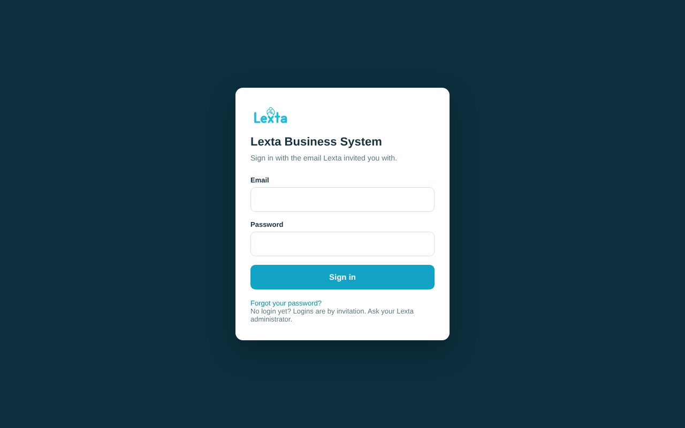

### Forgot your password?

1. On the sign in screen, tap **Forgot your password?**
2. Type your email and tap **Send reset link**.
3. Open the email and tap the link. Choose a new password (at least 10 characters) and tap **Save password**.

The screen always says "If that email has a login, a reset link is on its way". If no email arrives after a few minutes, check your spam folder, then ask your admin. A reset link works once; if it says "That link has expired or was already used", ask for a new one.

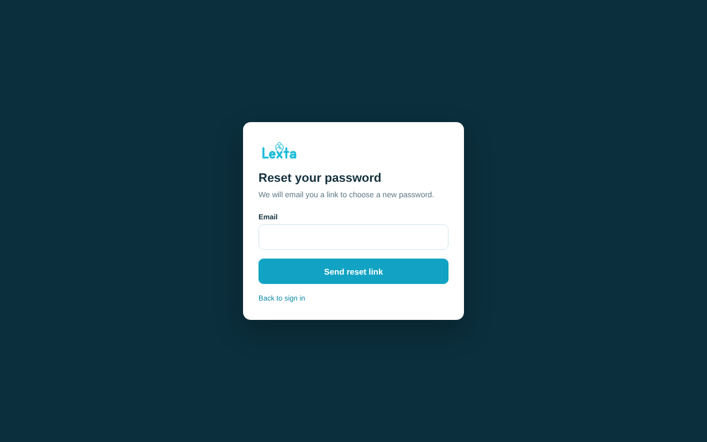

### Your menu depends on your role

Each person has one role. Your role decides which systems appear in your menu and on your Home screen. Your name and role show at the bottom of the menu (at the top on a phone).

| System | Admin | Management | Sales rep | Customer care | Marketing | HR | Distributor |
|---|---|---|---|---|---|---|---|
| Management dashboard | Yes | Yes | | | | | |
| Distributor ordering | Yes | Yes | Yes | | | | Yes (own orders only) |
| Field sales | Yes | Yes | Yes | | | | |
| CRM | Yes | Yes | Yes | Yes | Yes | | |
| Complaints | Yes | Yes | Yes | Yes | Yes | | |
| Product management | Yes | Yes | | | Yes | | |
| Stockists (Where to Buy) | Yes | Yes | Yes | Yes | Yes | | |
| CSR activities | Yes | Yes | | | Yes | | |
| Recruitment | Yes | Yes | | | | Yes | |
| Live chat inbox | Yes | Yes | | Yes | | | |
| Users and access | Yes | | | | | | |

Seeing a system does not always mean you can change everything in it. Each chapter below says who can do what.

**Brands.** Sales reps and marketing staff are also linked to the brands they work on (Yazz, Linzzy, Hooch). They see and change records of those brands. Admin and management see every brand. If you see "You are not linked to a brand yet", ask your admin to add your brands.

If your Home screen says "an administrator has not given you a role yet", your login works but you have no access yet. Ask your admin to set your role.

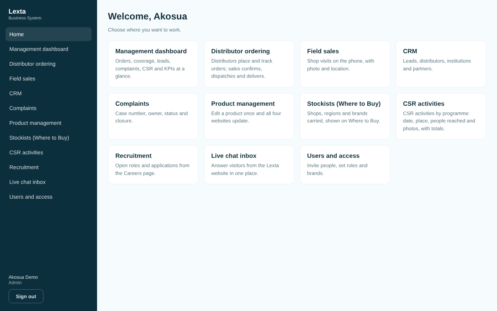

### Using it on a phone

The Business System fits a phone screen. On a phone the menu sits at the top of the screen as a row of buttons: swipe it sideways to see every system. Tables turn into cards you scroll down.

Field sales is made for the phone. See [chapter 4](#4-field-sales).

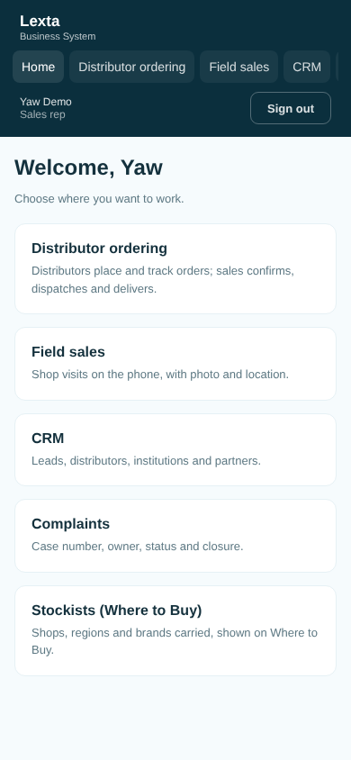

### Signing out

Tap **Sign out** under your name. Always sign out on a shared computer.

### Good to know

* The system saves when you tap the button (Save, Add, Change status and so on). If you leave a page without tapping it, your changes are lost.
* Green messages mean it worked. Red messages tell you what to fix. Fields with a problem are marked.
* Most lists have **Search** and filters at the top. Choose your filters, then tap **Apply**. Tap **Clear** to see everything again.
* Long lists show 50 at a time. Use **Previous** and **Next** at the bottom.
* "Delete" removes a record for good and asks you to confirm first. In most systems only admin can delete.
* Times are Ghana time.

---

## 2. Management dashboard

**Who can use it:** admin and management.

**What it is for:** the headline numbers from every system on one page: leads, complaints, distributor orders, shop visits, live chat, recruitment, CSR and the product catalogue.

**Video:** [Management dashboard: dates and brand](videos/11-dashboard.mp4) (37 seconds).

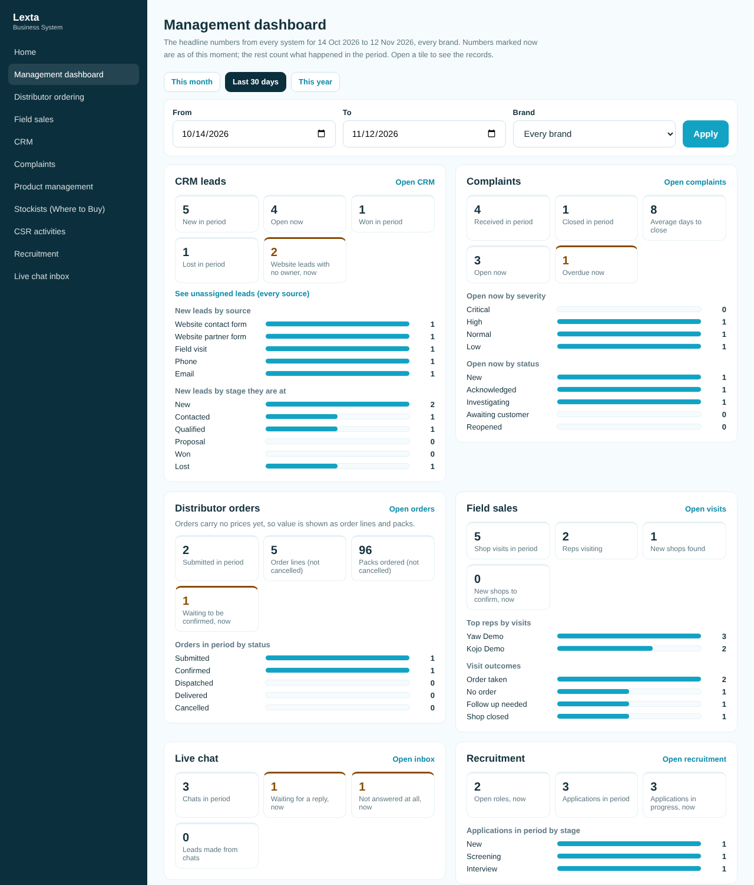

### Look at a period

1. Open **Management dashboard**.
2. Tap **This month**, **Last 30 days** (the default) or **This year**.
3. For your own dates, set **From** and **To** and tap **Apply**.

### Look at one brand

1. Choose a brand under **Brand**.
2. Tap **Apply**. Tap **Clear** to go back to every brand.

### Open the records behind a number

1. Tap a tile title or its link (for example **Open complaints**).
2. Many numbers are links too. For example, tap **Overdue now** to see the overdue complaints.

### Good to know

* Numbers marked "now" are as they are at this moment (for example "Open now"). The others count what happened in the period you chose.
* Numbers with a coloured top edge need attention (for example website leads with no owner, overdue complaints, orders waiting to be confirmed).
* Orders carry no prices yet, so order size is shown as order lines and packs.
* Recruitment is not split by brand. With a brand chosen, live chat counts that brand but the inbox still shows every chat.
* CSR totals only count activities marked done.

### Common questions

**Everything shows 0.** Nothing has been recorded for that period yet. Try **This year**.

**Can I download the dashboard?** Not from the dashboard. Several systems have their own **Export CSV** button (orders, field sales, recruitment).

---

## 3. Distributor ordering

**Who can use it:** admin, management and sales reps (the staff side); distributors (their own orders only).

**What it is for:** distributors place orders in the portal and follow them. Lexta staff confirm, dispatch and mark them delivered. The distributor sees each step.

**Video:** [Distributor ordering: place and confirm an order](videos/08-distributor-order.mp4) (57 seconds).

An order goes: **Draft** (only the distributor sees it), **Submitted**, **Confirmed**, **Dispatched**, **Delivered**. It can also be **Cancelled**.

### For Lexta staff

Sales reps see the orders for the brands they work on. Admin and management see all orders.

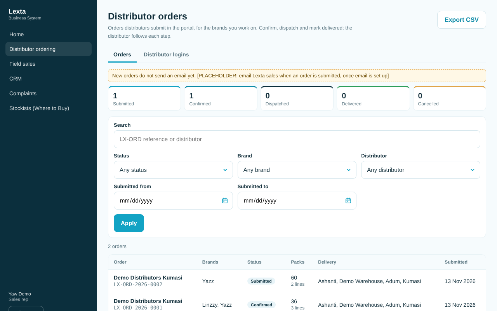

#### Work a new order

1. Open **Distributor ordering**. The boxes at the top count orders by status; tap **Submitted** to see orders waiting for you.
2. Tap the distributor's name to open the order.
3. Check the products, packs and **Delivery** details.
4. Under **Status**, tap **Confirm order**. You can add a **Note for the distributor** (for example "On the Tuesday truck").
5. Tap the **Confirm order** button below the note to save.

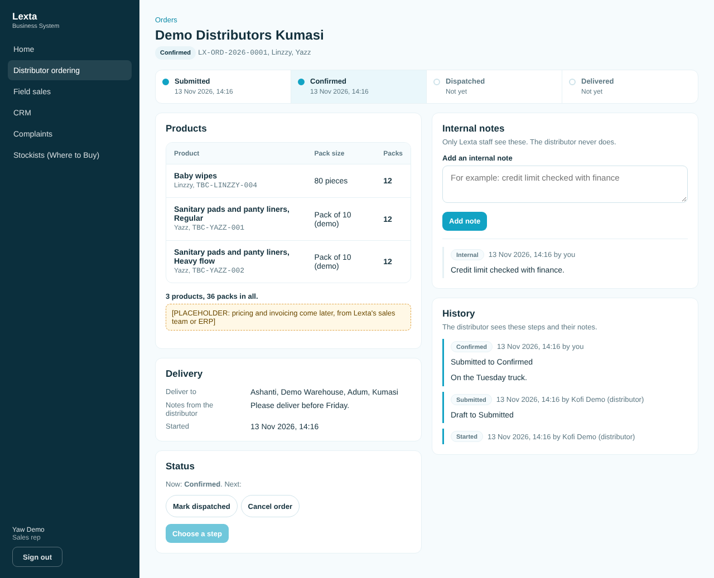

#### Dispatch and deliver

1. Open the order.
2. Under **Status**, tap **Mark dispatched**, add a note if you like, and tap the button to save.
3. When it arrives, open it again, tap **Mark delivered** and save.

#### Cancel an order

1. Open the order. Under **Status**, tap **Cancel order**.
2. Type the **Reason for cancelling**. This is required, and the distributor sees it.
3. Tap **Cancel order** to save.

A submitted or confirmed order can be cancelled. A dispatched order can only move to delivered.

#### Add an internal note

1. Open the order. Under **Internal notes**, type your note.
2. Tap **Add note**. Only Lexta staff see internal notes; the distributor never does.

#### Link a distributor login to its company

A distributor can only order once their login is linked to their company (an organisation in the CRM). The organisation's brands decide what they can order.

1. Open **Distributor ordering**, then the **Distributor logins** tab.
2. Find the person marked **Not linked**.
3. Choose their organisation under **Organisation for ...** and tap **Link**.
4. To stop a login seeing orders, tap **Unlink** and confirm.

If the company is not in the list, add it in the CRM first (see [chapter 5](#5-crm)) with the brands it carries. New distributor logins are created by your admin; ask your admin.

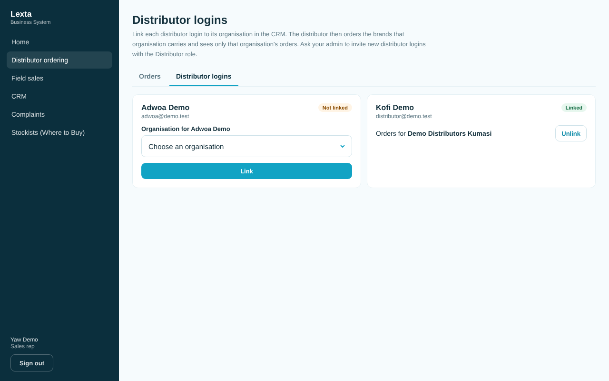

#### Export orders

Set the filters you want and tap **Export CSV**. The file opens in Excel.

### For distributors

Your menu shows **My orders**, **New order** and **Catalogue** only.

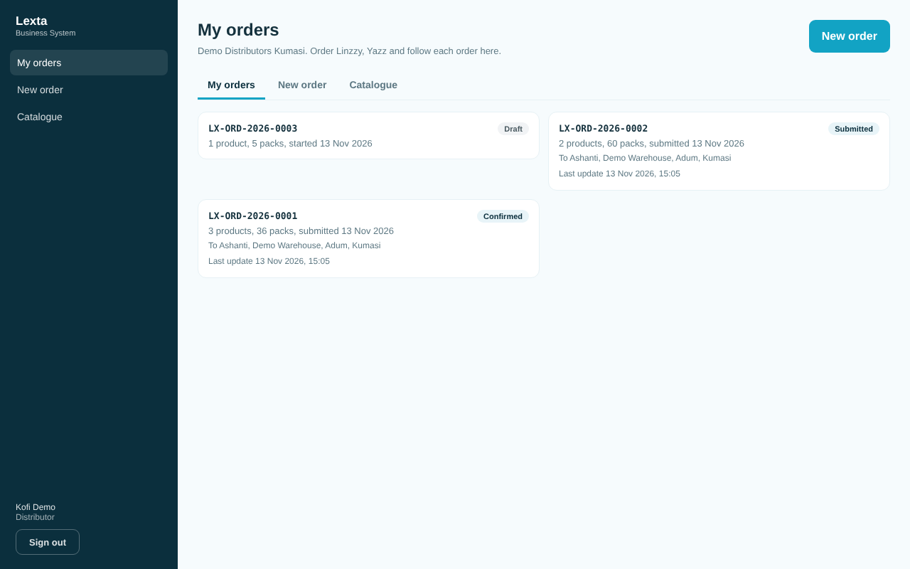

#### Place an order

1. Tap **New order**.
2. Find products by brand or with **Find a product**.
3. For each product, set the number of packs with **+** and **-**, or type the number.
4. Tap **Review order** at the bottom.
5. Check the list. Under **Delivery**, choose a **Region** or type a **Delivery address** (at least one is needed). Add **Notes for Lexta** if you like.
6. Tap **Submit order**. Or tap **Save as draft** to finish later.

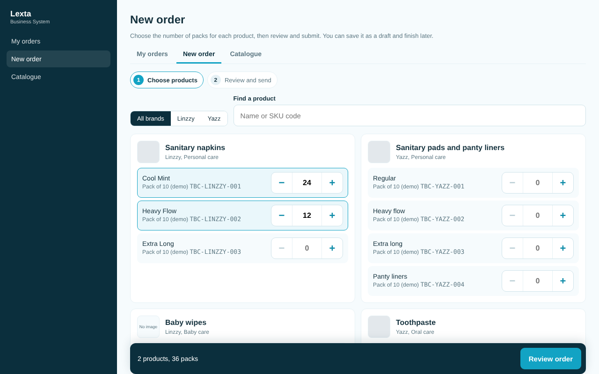

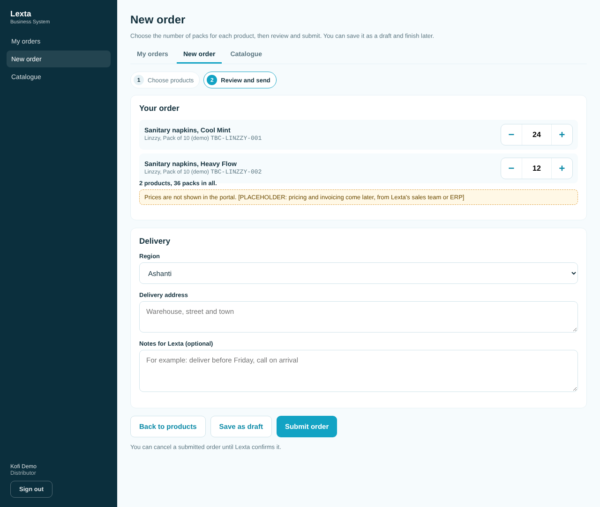

#### Follow or change an order

1. Tap **My orders** and tap an order. The tracker shows each step with its date and time.
2. A **draft** can be changed with **Edit draft**, sent with **Submit order** or dropped with **Drop draft**.
3. A **submitted** order can be cancelled with **Cancel order** until Lexta confirms it. After that, call your Lexta sales contact.

### Good to know

* Quantities are whole packs, at most 100,000 a line and 200 lines an order.
* Prices are not shown in the portal yet. Pricing and invoicing come later.
* No email is sent when an order is submitted yet. Staff should check the inbox for **Submitted** orders. Ask your admin when email alerts will start.
* If a product is no longer available, it is removed from a draft when you save it.
* Only admin can delete an order, and only for orders made by mistake. Cancel it instead.

### Common questions

**The distributor says "Not linked yet".** Link their login on the **Distributor logins** tab.

**The distributor sees "No products to order yet".** Their organisation's brands have no published products with pack sizes. Check the organisation's brands in the CRM, and the products in Product management.

---

## 4. Field sales

**Who can use it:** sales reps (on their phones), admin and management.

**What it is for:** log every shop visit with the shop, a photo, what happened, notes and your location. Managers see every visit.

**Video:** [Field sales: record a shop visit (phone)](videos/09-field-sales-phone.mp4) (33 seconds).

### For sales reps (on your phone)

Your Field sales screen shows a big **Start visit** button, your visits today, and the **My history** tab.

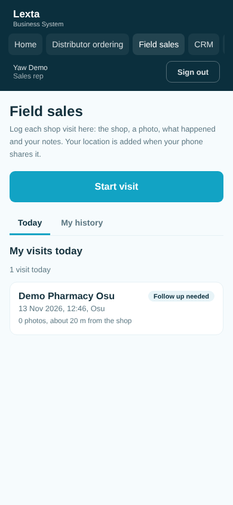

#### Log a shop visit

1. When you reach the shop, open **Field sales** and tap **Start visit**.
2. Allow location when your phone asks. You see "Location captured" with how accurate it is.
3. Under **Which shop are you at?** the shops of your brands are listed, nearest first. Tap your shop, or type its name or town in **Find a shop**.
4. Under **Photos**, tap **Take a photo** for the shelf or shop front, or **Choose from phone**. Photos are optional.
5. Under **What happened?**, tap the outcome (for example **Order taken**). Add **Notes** if you like: who you spoke to, what they need, when to come back.
6. If the shop is in the CRM, you can tick **Also log this visit on the CRM timeline**.
7. Optional: open **Quick stock check** and mark each product **On shelf** or **Not on shelf**, with the number of facings.
8. Tap **Save visit**. Wait for **Visit saved**, then tap **Start another visit** or **My visits today**.

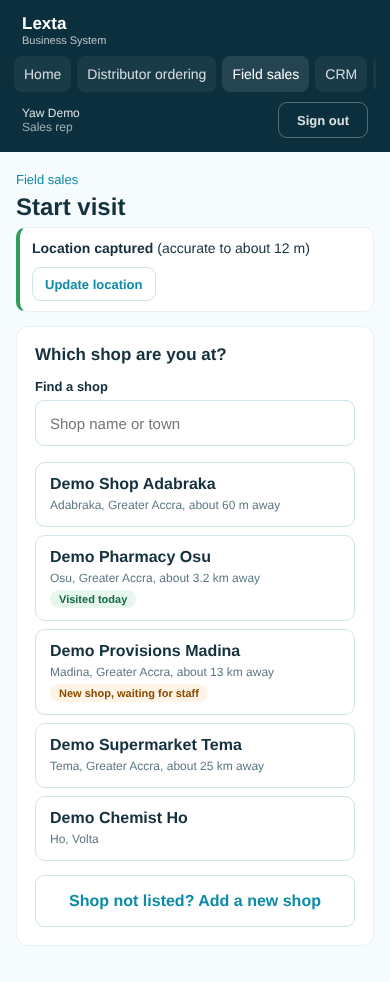

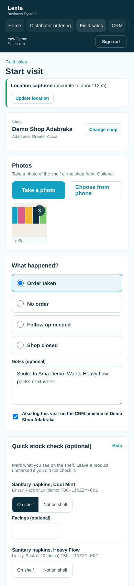

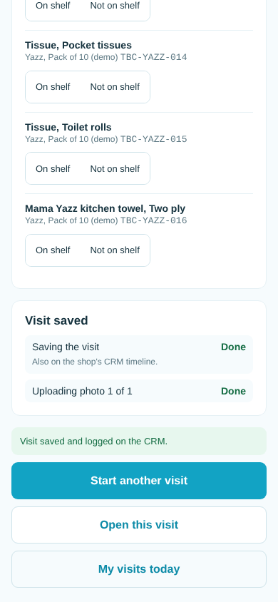

#### Add a new shop

1. On **Which shop are you at?**, tap **Shop not listed? Add a new shop**.
2. Fill in the **Shop name**, **Type of shop**, region, town and the **Brands the shop sells**. Address and phone are optional.
3. Finish the visit as usual and tap **Save visit**.

New shops do not appear on the website's Where to Buy until admin or marketing check them and switch them on in Stockists.

#### Change a visit

1. Open **My history** and tap the visit.
2. Under **Change this visit**, change the outcome, notes, stock check or photos and save.

You can change your own visit for 24 hours after you made it.

### For managers (admin and management)

1. Open **Field sales**. The **All visits** tab lists every visit.
2. Filter by rep, region, brand, outcome or dates and tap **Apply**.
3. Tap a shop name to open the visit with its photos, stock check and location. **Open in OpenStreetMap** shows where it was logged.
4. Tap **Export CSV** to download the list.

Managers can also log visits with **Log a visit**. Admin can change the outcome list on the **Outcomes** tab (add, switch off or delete), change any visit and delete visits.

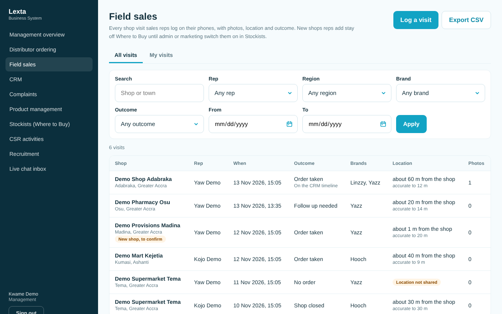

### Good to know

* A visit has at most 10 photos, each up to 5 MB (JPG, PNG or WebP).
* If you refuse location or it cannot be found, you can still log the visit; it is marked "Location not shared" or "Location not available".
* The list shows how far you were from the shop (for example "about 60 m from the shop").
* Bad network? The phone keeps trying ("Connection problem. Trying again"). Press **Try again** if asked. A visit is never saved twice.
* If photos fail with "Photo uploads are not set up yet", the visit itself is saved. Ask your admin.
* If you see "Your session has ended", tap **Sign in** (it opens in a new tab, so nothing is lost), sign in, come back and press **Try again**.
* Only admin and sales reps can add new shops.

### Common questions

**No shops are listed.** You are not linked to a brand yet, or no shops of your brands are listed. Ask your admin to add your brands; add the shop as a new shop.

**I picked the wrong shop.** Before saving, tap **Change shop**. The shop of a saved visit cannot be changed: ask your admin to delete the visit, then log it again.

---

## 5. CRM

**Who can use it:** admin, management, sales reps, marketing and customer care.

**What it is for:** one shared list of leads (possible sales), contacts (people) and organisations (distributors, retailers, institutions, partners, media, suppliers), each with a timeline of calls, visits and notes.

**Video:** [CRM: a website enquiry becomes a lead](videos/02-crm-website-lead.mp4) (63 seconds).

Leads move through stages: **New**, **Contacted**, **Qualified**, **Proposal**, **Won** or **Lost**.

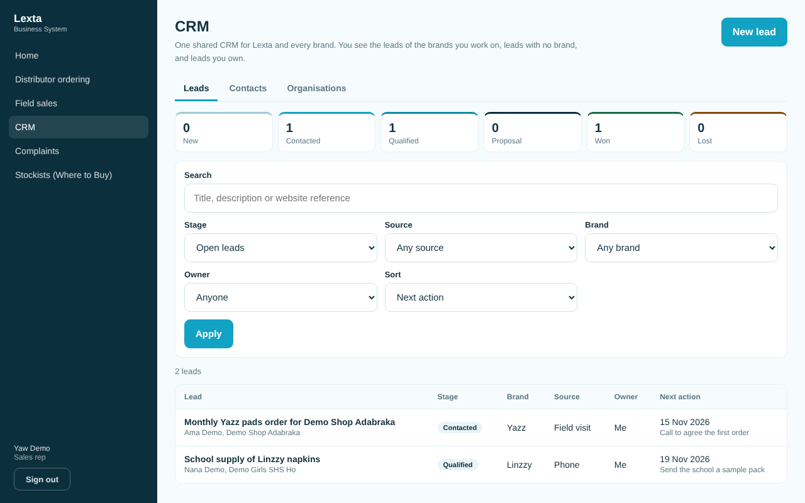

### Who can do what

* Admin and management: everything, including choosing the owner of any record.
* Sales reps and marketing: see and work records of their brands, records with no brand, and records they own. They can take an unowned lead with **Assign to me**.
* Customer care: add contacts, leads (at stage New) and timeline entries. They cannot change existing records.
* Only admin deletes records.

### Add a lead

1. Open **CRM**. On the **Leads** tab, tap **New lead**.
2. Type a **Title** (for example "200 cartons a month for a Kumasi wholesaler").
3. Choose the **Contact** and/or **Organisation** (at least one), the **Brand** and the **Source**.
4. Add the estimated monthly volume, a description and the **Next action** with a date if you know them.
5. Tap **Add lead**.

### Work a lead

1. Open the lead from the list.
2. To log what happened, choose the **Type** (call, meeting, visit, email or note), write **What happened**, and tap **Add to timeline**.
3. To move it on, choose the new stage under **Stage** and tap **Change stage**. For **Lost**, give the reason.
4. Update the **Next action** in the form and tap **Save changes**.

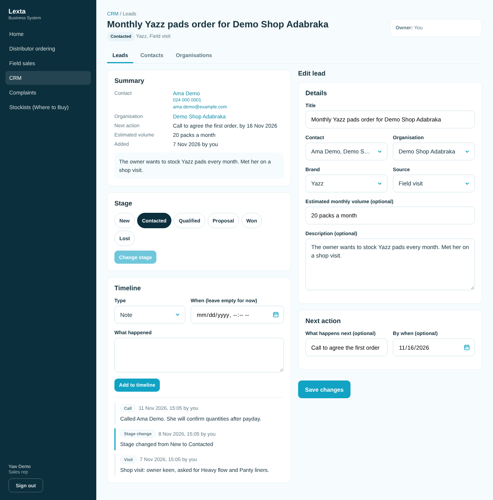

### Add a contact or an organisation

1. Open the **Contacts** or **Organisations** tab.
2. Tap **New contact** or **New organisation**.
3. Fill in the details and save. For an organisation, tick its **Brands of interest**.

Customer care cannot add organisations.

### Website leads

Messages from the website forms land in the CRM by themselves:

* **Contact Us** (every reason except Consumer care) makes a lead and a contact.
* **Partner With Us** makes a lead, a contact and an organisation.
* The **newsletter** sign up adds a contact with marketing consent.
* **Contact Us, Consumer care** goes to Complaints instead (see [chapter 6](#6-complaints)).

### Website lead managers (admin only)

Admin chooses who gets new website leads.

1. Open **CRM** and tap **Website lead managers**.
2. Choose a **Default manager**: they get every new website lead unless the brand has its own manager.
3. Under **Manager per brand**, choose a manager for a brand, or leave **Use default**.
4. Tap **Save managers**. **Recent changes** shows who changed what.

A sales rep or marketer can only manage a brand they work on. If nobody is chosen, website leads stay unassigned; the dashboard shows how many.

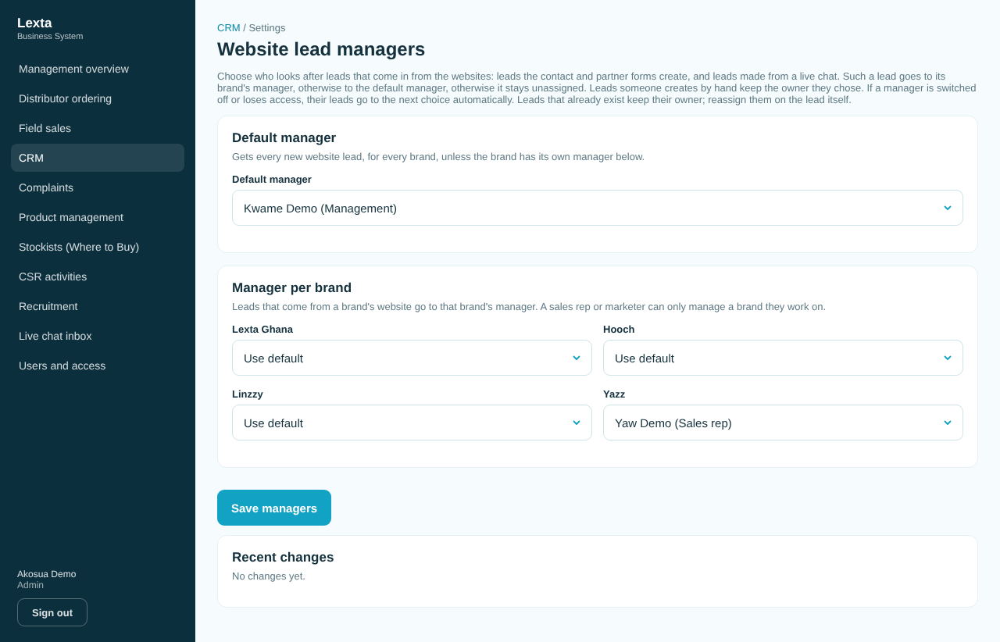

### Good to know

* The lead list shows open leads by default. Choose **All stages** under **Stage** to see won and lost ones too.
* Use **Owner: Unassigned** to find leads nobody has taken.
* Estimated volume is quantities only, never prices.
* An organisation with leads cannot be deleted until its leads are moved or deleted.

### Common questions

**I cannot change the brand of a lead.** Sales reps and marketing must own the lead first: tap **Assign to me**. This only works on a lead nobody owns; if a colleague owns it, ask them or a manager.

**I cannot see a lead a colleague mentioned.** It is for a brand you do not work on. Ask its owner or a manager.

---

## 6. Complaints

**Who can use it:** admin and customer care work complaints. Management can read all complaints, assign owners and add notes. Sales reps and marketing can read the complaints of their brands and add notes, calls and emails.

**What it is for:** every consumer complaint gets a case number (for example LX-2026-0001), an owner, a severity with target times, a status and a timeline until it is closed.

**Video:** [Complaints: log, acknowledge and resolve](videos/03-complaints.mp4) (73 seconds).

Status goes: **New**, **Acknowledged**, **Investigating**, **Awaiting customer**, then **Resolved** and **Closed**. A closed case can be **Reopened**.

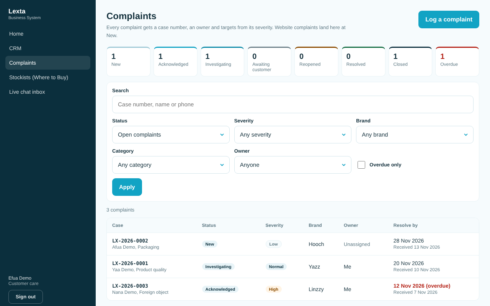

### Log a complaint (phone, walk in, email or social media)

1. Open **Complaints** and tap **Log a complaint**.
2. Under **Find the customer**, type their name, phone or email and tap **Find**. Tap **Use** if they are already in the CRM. If not, type their name and a phone or email; they are added to the CRM.
3. Choose **How it came in**, **What it is about** and the **Severity**. Type **What the customer said**.
4. Choose the **Brand** (use Lexta Ghana for anything not about one brand). Add the product, pack size, batch number, date bought and where it was bought if you know them.
5. Choose the **Owner** (or leave it for now) and tap **Log complaint**. The case number appears.

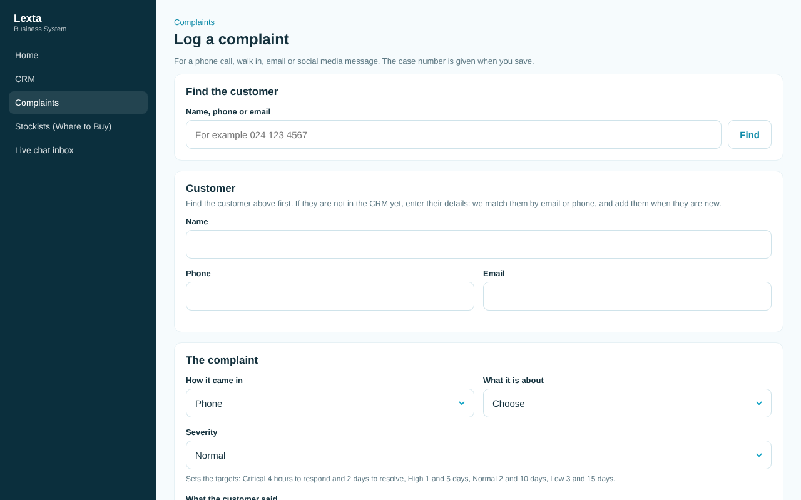

### Take and work a case

1. Open the case. If it has no owner, tap **Assign to me** (customer care) or choose an owner (admin and management).
2. Under **Status**, tap the next status (for example **Acknowledged**) and tap **Change status**.
3. Log every call, email and note: choose the **Type**, write **What happened**, tap **Add to timeline**.
4. Add photos of the product, batch code or receipt under **Files**: choose the file and tap **Upload**.

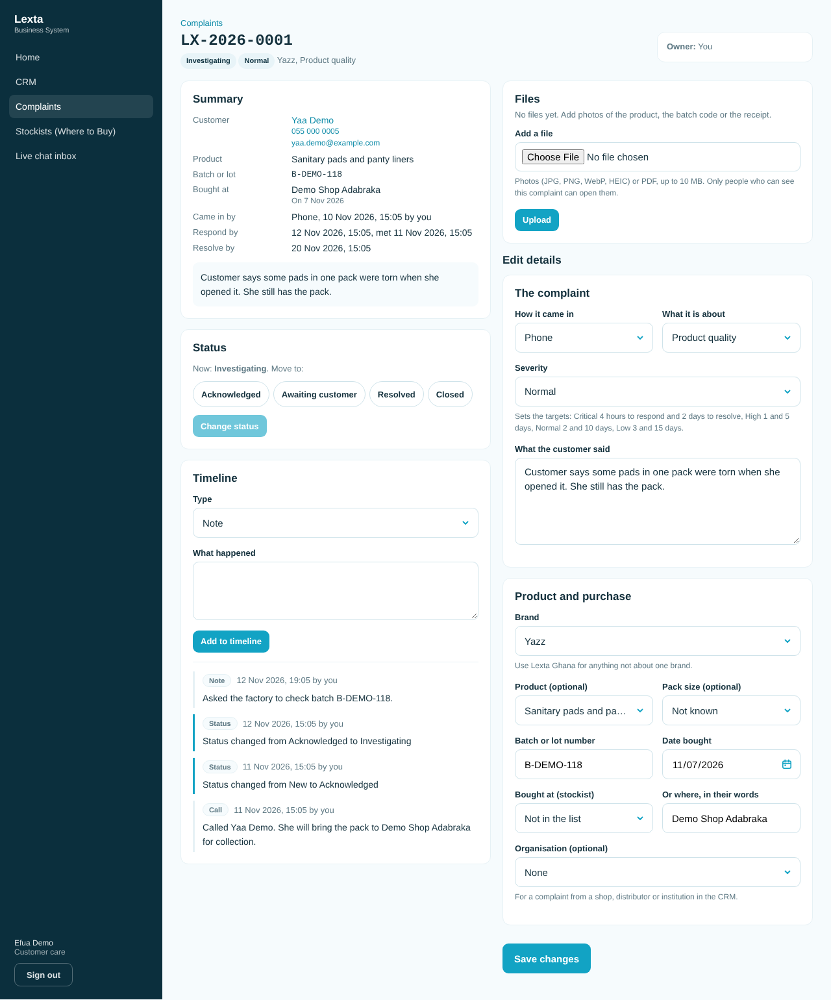

### Close a complaint

1. Open the case. Under **Status**, tap **Resolved**.
2. Write **How it was resolved** and the **Root cause**, then tap **Change status**.
3. When the customer is satisfied, tap **Closed** and **Change status**.

You can also close straight away; closing needs **How it was resolved**.

### Reopen a complaint

1. Open the closed case. Under **Status**, tap **Reopened**.
2. Write **Why reopen it** and tap **Change status**.

### Good to know

* Severity sets the targets: Critical 4 hours to respond and 2 days to resolve; High 1 day and 5 days; Normal 2 and 10 days; Low 3 and 15 days. Late cases are marked **Overdue**.
* A health or safety concern or a foreign object is always at least High.
* Website complaints (Contact Us, reason Consumer care) arrive at **New** with no owner.
* Files: photos (JPG, PNG, WebP, HEIC) or PDF, up to 10 MB each. Only people who can see the complaint can open them.
* A closed case is read only. You can still add notes, calls and emails. Reopen it to change details, owner or files.
* Only admin deletes a complaint, and only one logged by mistake.

### Common questions

**I am a sales rep. Can I log a complaint?** No. Pass the customer's details to customer care, or add a note to an existing complaint.

**The owner list does not show my colleague.** Only active admin and customer care people can own complaints.

---

## 7. Product management

**Who can use it:** admin and marketing (change); management (read only).

**What it is for:** one place for every product, its pack sizes (SKUs) and images. Edit a product once and the Lexta website shows the change (the brand sites will too, once they are built).

**Video:** [Product management: edit a product](videos/06-products.mp4) (29 seconds).

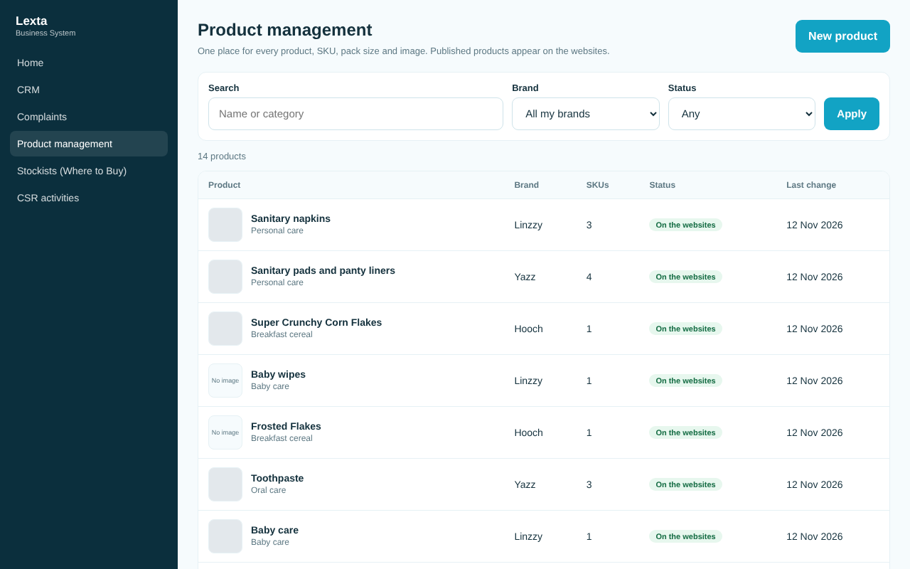

### Change a product

1. Open **Product management** and tap the product.
2. Change the details: name, category, descriptions, display order, key features, how to use, ingredients.
3. Under **SKUs and pack sizes**, change or **Add a SKU** (SKU code, variant, pack size, barcode). Untick **Active** to stop a pack size being ordered.
4. Tap **Save changes**. The message "Saved. The websites will show the change shortly" confirms it.

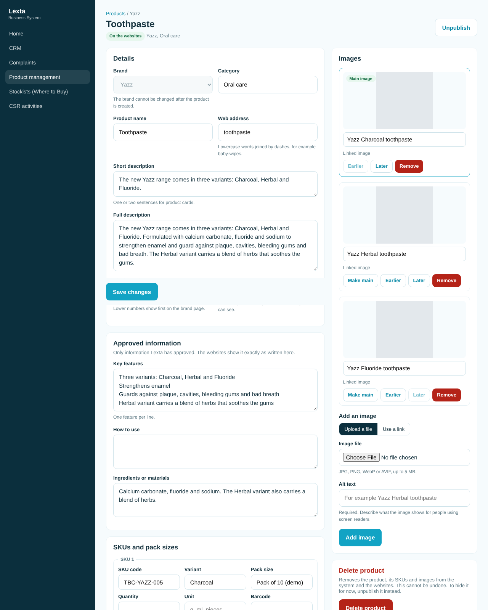

### Add a product

1. Tap **New product**.
2. Choose the **Brand** (it cannot be changed later), type the name and details, and add the SKUs.
3. Tap **Create product**.
4. Add images on the next screen (see below), then publish.

### Add or change images

1. Open the product and go to **Images**.
2. Choose **Upload a file** (JPG, PNG, WebP or AVIF, up to 5 MB) or **Use a link**.
3. Write the **Alt text**: a short description of what the image shows. It is required.
4. Tap **Add image**. Use **Make main**, **Earlier**, **Later** and **Remove** to arrange them.

### Publish or hide a product

1. Open the product and tap **Publish** to show it on the websites, or **Unpublish** to hide it.
2. Unpublished products stay as drafts that only staff see.

### Good to know

* Only put information Lexta has approved in **Approved information**. The websites show it exactly as written.
* You only see the brands you are linked to. If you see "No brands assigned yet", ask your admin.
* Published products also feed the distributor catalogue and the field sales stock check.
* Some pack sizes still say "[PLACEHOLDER: pack size from Lexta]". Replace them with the real pack sizes.
* Deleting a product removes it from the system and the websites for good. Unpublish it instead if you only want to hide it.

---

## 8. Stockists (Where to Buy)

**Who can use it:** admin, sales reps and marketing (add and change); management and customer care (read only).

**What it is for:** the list of shops, supermarkets, pharmacies, markets and distributors that sell Yazz, Linzzy and Hooch. Active stockists show on the website's **Where to Buy**.

**Video:** [Stockists: add a shop](videos/07-stockists.mp4) (47 seconds).

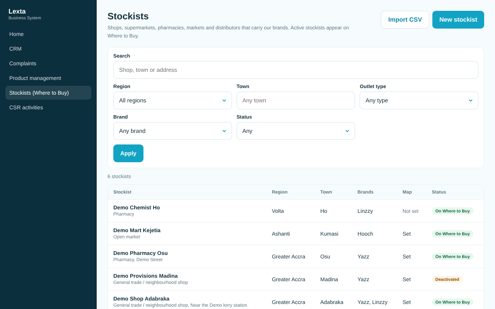

### Add a stockist

1. Open **Stockists (Where to Buy)** and tap **New stockist**.
2. Type the **Shop name**, choose the **Outlet type** and **Region**, and type the **Town**.
3. Add phone, address or landmark and opening hours if you have them.
4. For the map position, stand at the shop entrance and tap **Use my location**, or type the latitude and longitude from Google Maps.
5. Tick the **Brands carried**.
6. Tap **Add stockist**. It shows on Where to Buy while it is active.

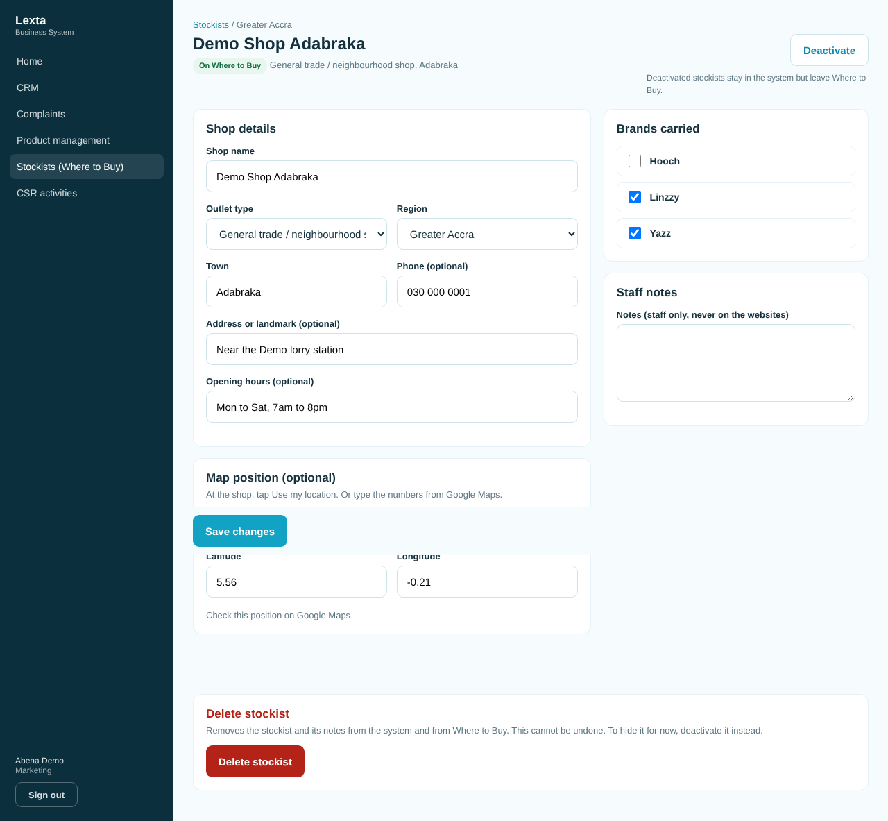

### Import many shops from a spreadsheet (CSV)

1. Save your spreadsheet as CSV with this first line: `name,outlet_type,region,town,address,phone,latitude,longitude,brands`
2. Open **Stockists** and tap **Import CSV**.
3. Choose the file, or paste the text.
4. Tap **Check rows**. Rows with problems are listed with what to fix.
5. Fix the file and check again, or tap **Import ... valid rows** to load the good rows now.

Rules for the file: outlet_type is supermarket, pharmacy, open market, general trade, distributor or other; region is one of Ghana's 16 regions (or Liberia (Monrovia)); separate brands with a semicolon (for example `Yazz; Hooch`). At most 2,000 shops and 1 MB a file.

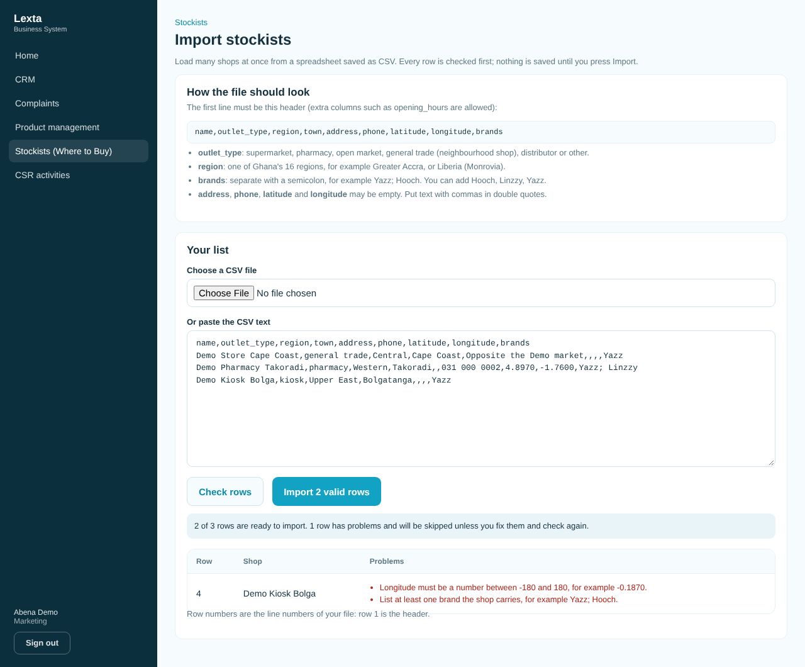

### Hide or confirm a stockist

1. Open the stockist.
2. Tap **Deactivate** to take it off Where to Buy (it stays in the system), or **Reactivate** to show it again.

New shops added by sales reps in Field sales start deactivated. Filter **Status: Deactivated** to find them, check them, then tap **Reactivate**. Only admin or marketing can switch these new shops on.

### Good to know

* Sales reps and marketing can change a stockist only if every brand it carries is one of theirs. On a shop that carries other brands too, they can add or remove their own brands only (**Save my brands**).
* **Staff notes** are never shown on the websites.
* Deleting removes the stockist for good. Deactivate it instead to hide it.

---

## 9. CSR activities

**Who can use it:** admin and marketing (log and change); management (read only).

**What it is for:** record every CSR activity: the programme, date, place, people reached, partners, notes and photos, with totals per programme.

**Video:** [CSR activities: log an activity with a photo](videos/10-csr.mp4) (41 seconds).

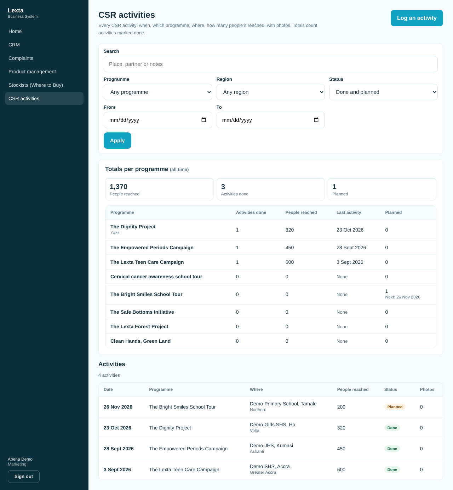

### Log an activity

1. Open **CSR activities** and tap **Log an activity**.
2. Choose the **Programme** and **Date**, and tick **Done** or **Planned**.
3. Choose the **Region** and type the **Town or place** (for example the school's name).
4. Type the **People reached** (for a planned activity, the number you expect). Add partners and notes if you like.
5. Tap **Save activity**.
6. On the next screen, add photos: **Take a photo** or **Choose photos**.

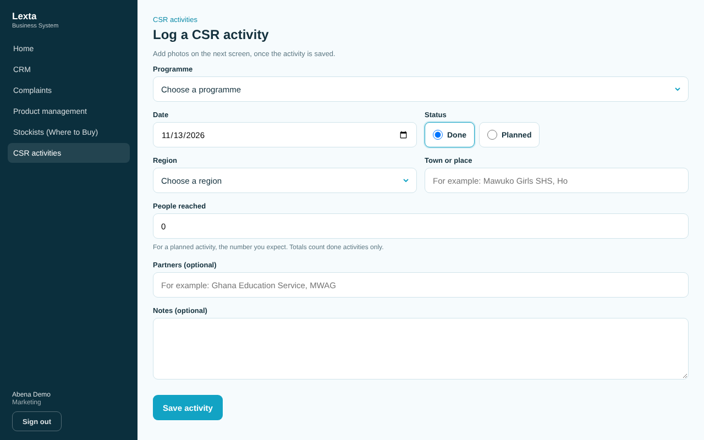

### Mark a planned activity as done

1. Open the activity from the list.
2. Under **Change this activity**, tick **Done**, correct the people reached and save.

### Manage programmes (admin only)

1. Open the **Programmes** tab.
2. Add a programme with **Add programme**, or edit, **Switch off** or delete one.
3. Programmes copied from the website are marked "From the website, check and edit". Check them and tap **Save as checked**.

### Good to know

* Totals count activities marked **Done** only. Planned ones show as "Next" in the totals table.
* Up to 20 photos an activity, each up to 5 MB (JPG, PNG or WebP). Large photos are made smaller before they are sent.
* If photos fail with "Photo uploads are not set up yet", the activity is saved. Ask your admin.
* Marketing can log activities for programmes with no brand or of a brand they work on.
* A programme with activities cannot be deleted; switch it off. Only admin deletes activities.

---

## 10. Recruitment

**Who can use it:** admin, management and HR.

**What it is for:** the job roles shown on the Careers page of the Lexta website, and the applications that come from it, each with the CV, a stage and an owner.

**Video:** [Recruitment: an application from Careers](videos/04-recruitment.mp4) (64 seconds).

### How the Careers page feeds it

1. HR creates a role and sets it to **Open**. It shows on the Careers page from its opening date to the end of its closing date.
2. A visitor applies on the Careers page with their CV (PDF or Word, up to 4 MB).
3. The application lands in **Recruitment** at stage **New**, with a reference like LX-APP-2026-0001.

Stages: **New**, **Screening**, **Shortlisted**, **Interview**, **Offer**, **Hired**, **Rejected**, **Withdrawn**.

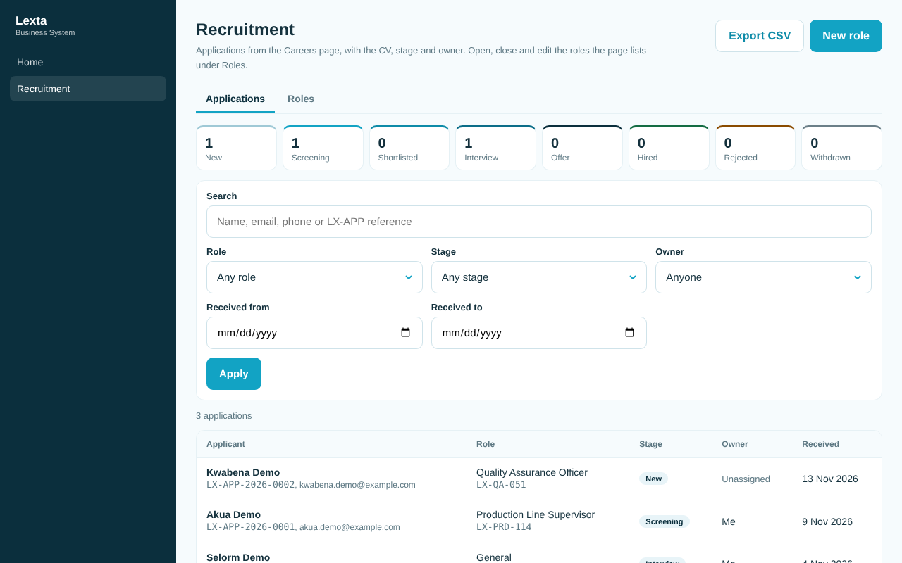

### Work an application

1. Open **Recruitment** and tap the applicant's name.
2. Tap **Download CV** to read the CV. It downloads with your own login; there is no link to share.
3. Set the **Owner** and tap **Set owner**.
4. Under **Stage**, choose the next stage, add a note if you like, and tap **Change stage**.
5. Add to the history with **Add note** (for example "called, interview booked for Monday 10am"). Keep longer notes in **Staff notes** and tap **Save notes**.

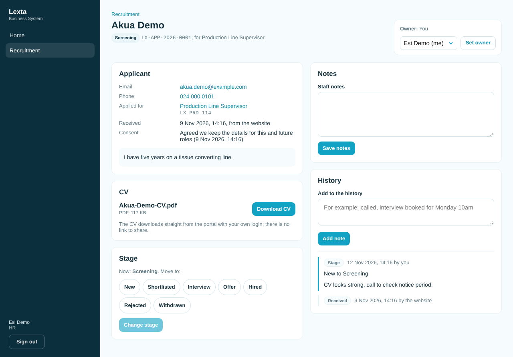

### Open, close or edit a role

1. Open the **Roles** tab and tap a role, or tap **New role**.
2. Fill in the reference, title, department, location, type, level, summary, duties and requirements (one per line, up to 20).
3. Set the **Opening date** and **Closing date**. Tick **Show "Closing soon"** if you want that label.
4. Tap **Create role** or **Save role**.
5. Use **Open role**, **Close role**, **Reopen role** or **Back to draft** to change its status.

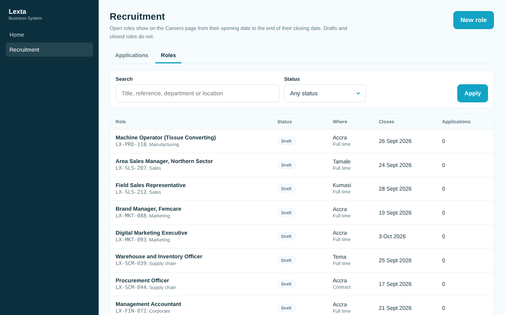

### Good to know

* The 12 roles from the old Careers page are there as drafts. Check them, set dates and open the ones Lexta is hiring for.
* A role with applications cannot be deleted; close it.
* **Export CSV** downloads the application list with your filters.
* Only admin deletes an application (for example when the applicant asks for their data to be erased).
* **Unclaimed CV uploads** are CVs from applications that were never sent. Tap **Remove unclaimed uploads** now and then.

---

## 11. Live chat inbox

**Who can use it:** admin, management and customer care.

**What it is for:** answer website visitors who use the chat on the website, all in one inbox. Every answer comes from a person; there is no chatbot. Today the chat is on the Lexta website; the brand sites will use the same inbox when they are built.

**Video:** [Live chat: reply to a visitor](videos/05-live-chat.mp4) (40 seconds).

Chat status: **Open** (the visitor is waiting for you), **Waiting for visitor** (you replied), **Closed**.

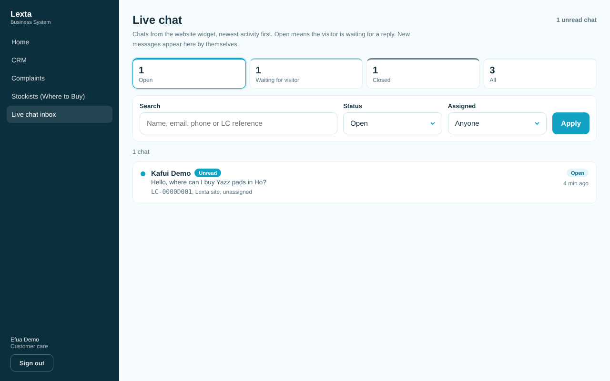

### Answer a chat

1. Open **Live chat inbox**. New and unread chats are marked. The inbox updates by itself every few seconds.
2. Tap the chat.
3. Tap **Assign to me** so colleagues know you have it.
4. Type in **Reply to the visitor** and tap **Send reply** (or press Enter; Shift and Enter makes a new line).

The visitor sees your first name only.

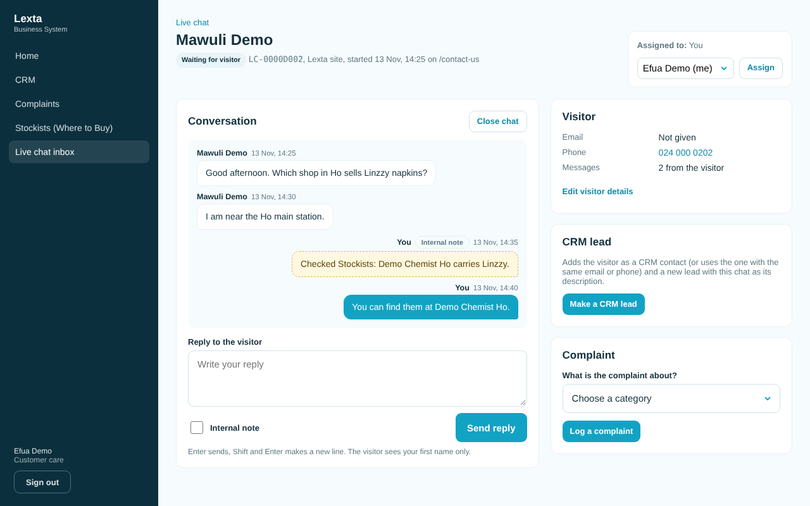

### Add an internal note

1. Tick **Internal note** under the reply box.
2. Type the note and tap **Add note**. The visitor never sees it.

### Turn a chat into a lead or a complaint

1. To make a CRM lead, tap **Make a CRM lead**. The visitor is added as a contact and the chat becomes the lead's description.
2. To log a complaint, add the visitor's email or phone first (**Edit visitor details**), choose **What is the complaint about?** and tap **Log a complaint**.

Management can make leads but not complaints; assign the chat to customer care instead.

### Close or reopen a chat

1. Tap **Close chat** when it is finished.
2. Tap **Reopen chat** to reply again. If the visitor writes again, the chat opens by itself.

### Good to know

* Outside office hours the website tells visitors the team is away and to leave a message. The office hours shown on the website are not set yet; ask your admin.
* Only admin can delete a chat (for example when the visitor asks for their data to be erased).
* Sales reps, marketing and HR do not see the chat inbox.

---

## 12. Users and access

**Who can use it:** admin only.

**What it is for:** inviting people, setting their role and the brands they work on, and switching logins off.

**Today:** the **Users and access** screen in the portal still says "Being built". Until it is ready, new logins, roles and brand links are set up for you by the admin team behind the system.

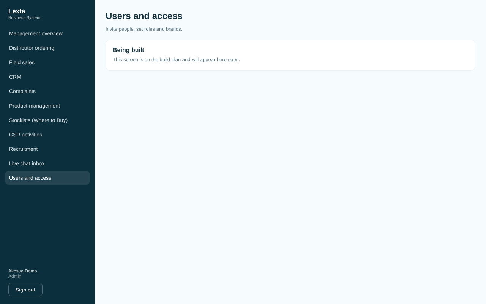

### To get someone access (for now)

1. Send your admin the person's full name, work email, role (admin, management, sales rep, customer care, marketing, HR or distributor) and, for sales reps and marketing, their brands.
2. The person gets an invitation email and chooses a password (see [Signing in](#signing-in)).
3. For a distributor, link the new login to its company on the **Distributor logins** tab (see [chapter 3](#3-distributor-ordering)).

### To remove someone's access

Ask your admin to switch off their login. When someone leaves, their records stay; their name shows as "Former team member".

### Good to know

* A person has one role. Admin and management see every brand; other roles see the brands they are linked to.
* A login with no role sees "No access yet".

[PLACEHOLDER: steps and screenshot for the Users and access screen, once it is built]

---

## 13. Who to ask

| Question | Ask |
|---|---|
| I cannot sign in, or I need a login, role or brand | Your Lexta admin |
| Something on a screen looks wrong or a button does not work | Your Lexta admin, who passes it to the IT team |
| Photo uploads say "not set up yet" | Your Lexta admin |
| A distributor cannot order | Their Lexta sales contact (to link the login) |
| Product information or pack sizes | Marketing |
| A complaint from a customer | Customer care |
| Jobs and applications | HR |

[PLACEHOLDER: names, phone numbers and emails of Lexta's admin and IT contacts]

---

## 14. Glossary

| Word | Meaning |
|---|---|
| Admin | The role that can do everything, including deletes and settings |
| Brand | Yazz, Linzzy or Hooch (Lexta Ghana is the company brand) |
| Case number | A complaint's number, for example LX-2026-0001 |
| CRM | The shared list of leads, contacts and organisations |
| CSV | A spreadsheet file format Excel can open and save |
| Draft | Saved but not sent or not shown on the websites yet |
| Facings | How many packs of a product face the customer on the shelf |
| Internal note | A note only Lexta staff see |
| Lead | A possible sale or partnership being followed up |
| Organisation | A company or institution in the CRM, for example a distributor |
| Outcome | What happened on a shop visit, for example Order taken |
| Owner | The person responsible for a lead, complaint, application or chat |
| Publish | Show a product on the websites |
| Role | Your job type in the system; it decides what you see |
| SKU | One pack size or variant of a product, with its own code |
| Stockist | A shop or outlet that sells Lexta brands, shown on Where to Buy |
| Timeline | The list of everything that happened on a record, newest first |
| Where to Buy | The shop finder on the websites |
